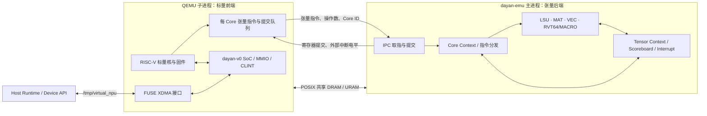

# Dayan-emu

Dayan-emu 是 Dayan NPU 的功能级模拟器。它与仓库内定制的
`npu-qemu` 配合运行：QEMU 负责 RISC-V 标量核、固件启动、SoC 外设和 Host
接口，Dayan-emu 负责张量指令的取指、分发与 LSU/MAT/VEC/MACRO 功能执行。

当前版本支持 1～8 个计算 Core、每 Core 独立 URAM、Core 间 URAM 访问、共享
DRAM、Tensor Context、Scoreboard 和张量异常/中断上报。

## 架构

### QEMU 与 Dayan-emu 分离

QEMU 没有链接进 Dayan-emu。`bin/dayan-emu` 同时承担张量后端和进程启动器的
职责：它先创建共享内存，再 `fork/exec` 一个独立的 QEMU 子进程，随后建立 IPC
通道并运行各个张量执行单元。



在源码和 IPC 接口中，QEMU 被称为 **frontend**，Dayan-emu 被称为
**backend**。一次张量指令的大致流程是：

1. 固件在 QEMU 中执行。QEMU 遇到 Dayan 张量指令后，将指令、`rd/rs1/rs2`
   寄存器值和 Core ID 放入对应 Core 的队列。
2. Dayan-emu 轮询各 Core，通过 IPC 取走指令并交给 `core_context_t`。
3. 指令被分发到 LSU、MAT、VEC 或 RVT64/MACRO；每个执行单元有独立执行线程，
   Tensor Context、Scoreboard 和中断控制器属于对应 Core。
4. 需要回写标量寄存器的结果通过消息通道提交回 QEMU；张量异常会更新对应
   RISC-V Hart 的外部中断电平。
5. DRAM 和 URAM 数据直接通过共享内存访问，不经过逐字节 IPC 拷贝。

### 进程间接口

| 资源 | 方向 | 用途 |
| --- | --- | --- |
| `/tmp/card0_dayan_inst_req` | Dayan-emu → QEMU | 请求指定 Core 的下一条张量指令 |
| `/tmp/card0_dayan_inst_rsp` | QEMU → Dayan-emu | 返回有效标志、指令、操作数和时间戳 |
| `/tmp/card0_dayan_msg` | 主要为 Dayan-emu → QEMU | 寄存器提交、中断电平更新；协议也保留内存读写消息 |
| `/dram_shm_0` | 双方共享 | 4 GiB DRAM，Guest 基地址为 `0x8000_0000` |
| `/uram_shm_<core>` | 双方共享 | 每 Core 1.5 MiB URAM；Guest 基地址为 `0x0080_0000 + core × 0x0020_0000` |

ClusterMMU 只翻译 ≥ `0x8000_0000`（DRAM 通路）的地址；低 2GiB（URAM 与控制空间）
恒为直通，页表/FixMap 重映射对其不生效。

IPC Socket 和共享内存名称目前固定为 `card0`/上述名称，因此同一主机命名空间内
只能可靠运行一个模拟器实例。

### QEMU 侧平台

子模块中的 `dayan-v0` Machine 提供 RISC-V Hart、Boot ROM、Mailbox、
NPU-to-Host Interrupt Handler、Dayan CLINT、Atomic Cache 窗口、每 Core URAM
和共享 DRAM。QEMU 还会在 `/tmp/virtual_npu/` 挂载 FUSE 文件系统，向 Host
Runtime 暴露：

- `xdma0_user`
- `xdma0_h2c_0`
- `xdma0_c2h_0`
- `xdma0_events_0`

### 目录结构

| 路径 | 内容 |
| --- | --- |
| `main/` | 命令行解析、共享内存创建、QEMU 子进程和多 Core 主循环 |
| `emu/` | Core Context、LSU、MAT、VEC 实现 |
| `rvt64/` | RVT64/MACRO 执行单元 |
| `include/` | 指令解码、IPC、Tensor Context、中断和执行单元接口 |
| `utils/` | 通用执行与中断实现 |
| `tests/` | LSU、MAT、VEC、Context 和中断单元测试 |
| `deps/npu-qemu/` | 固定版本的定制 QEMU 子模块 |

## 环境要求

- Linux；需要 POSIX Shared Memory 和 FUSE 3。
- 支持 C++20 的 GCC/G++、GNU Make、Git、Python 3、Ninja 和 `pkg-config`。
- `/dev/shm` 至少能容纳 4 GiB DRAM、所有 URAM 及系统余量。项目运行时提示推荐
  配置为 32 GiB；Docker 默认的 64 MiB 不够。
- 当前用户需要能够访问 `/dev/fuse`，并能在 `/tmp/virtual_npu` 上挂载 FUSE。

本仓库不包含 Boot ROM、Runtime 或测试 Kernel。运行完整软件栈时，还需要由
`npu-firmware`、`npu-kernels` 等仓库提供相应 ELF 产物；下文使用路径占位符说明
如何传入这些文件。

Ubuntu/Debian 可先安装一组基础依赖：

```bash
sudo apt-get update
sudo apt-get install -y \
  build-essential git python3 python3-venv ninja-build pkg-config \
  fuse3 libfuse3-dev libglib2.0-dev libpixman-1-dev zlib1g-dev
```

在容器中运行时，需要为容器配置足够的共享内存，并允许使用 FUSE，例如启动容器
时加入 `--shm-size=32g --device=/dev/fuse --cap-add=SYS_ADMIN`。具体权限策略应按
运行环境收紧。

运行前确保挂载点存在：

```bash
mkdir -p /tmp/virtual_npu
```

如果宿主机的 `/dev/shm` 容量不足，可调整挂载大小：

```bash
sudo mount -o remount,size=32G /dev/shm
```

## 构建

首次拉取后初始化 QEMU 子模块：

```bash
make deps
```

构建 QEMU 和 Dayan-emu：

```bash
make
```

产物为：

- `bin/dayan-emu`
- `deps/npu-qemu/build/dl-riscv64`

根目录 `make` 会自动配置并增量构建 QEMU。也可以只构建 QEMU：

```bash
make qemu
```

常用构建参数：

```bash
# Dayan-emu Debug 构建：-O0、调试信息和 AddressSanitizer
make clean
make BUILD_TYPE=Debug

# 调整 QEMU 并行编译任务数
make qemu NPU_QEMU_JOBS=32

# 使用其他兼容的 QEMU 源码目录或已有可执行文件
make clean
make NPU_QEMU_DIR=/path/to/npu-qemu

make clean
make NPU_QEMU_BIN=/path/to/compatible-qemu
```

`NPU_QEMU_BIN` 的绝对路径会在编译 Dayan-emu 时写入默认启动配置。更换该变量后应
先执行 `make clean`，再重新构建 `bin/dayan-emu`。QEMU 子构建不会继承 Dayan-emu 的 sanitizer、
`-march` 或 C/C++ 语言标准选项。

## 运行

命令格式：

```text
./bin/dayan-emu [-c N|--cores N] [QEMU 可执行文件及参数...]
```

- Core 数量范围为 1～8，默认为 1。
- `-c/--cores` 必须放在自定义 QEMU 命令之前。
- Dayan-emu 总会向 QEMU 传递与 Core 数一致的 `-smp N`。如果同时指定 `-c` 和
  QEMU `-smp`，以 `-c` 为准；只指定 `-smp` 时，Dayan-emu 会采用该值。
- 自定义前端必须实现本仓库的共享内存和三路 Socket 协议。普通的上游 QEMU
  不能直接替代定制 `dl-riscv64`。

查看启动器帮助：

```bash
./bin/dayan-emu --help
```

### 默认调试模式

不提供 QEMU 命令时，启动器使用构建时写入的 QEMU 路径，并等价执行：

```text
deps/npu-qemu/build/dl-riscv64 \
  -monitor null \
  -bios /workspace/npu-firmware/bl0/bootrom.elf \
  -machine dayan-v0 \
  -nographic \
  -m 4096 \
  -smp <Core 数> \
  -S -s
```

因此默认模式要求 Boot ROM 位于上述固定路径，并会暂停 CPU、在 TCP 1234 端口
等待 GDB：

```bash
./bin/dayan-emu          # 1 Core
./bin/dayan-emu -c 4     # 4 Core
```

可使用 RISC-V GDB 连接：

```gdb
target remote :1234
continue
```

### 自定义固件路径

固件不在默认位置，或不希望等待 GDB 时，将完整 QEMU 命令传给启动器：

```bash
./bin/dayan-emu -c 4 \
  ./deps/npu-qemu/build/dl-riscv64 \
  -monitor null \
  -bios /path/to/npu-firmware/bl0/bootrom.elf \
  -machine dayan-v0 \
  -nographic \
  -m 4096
```

启动器会在命令末尾自动加入 `-smp 4`。

### 裸机 Kernel 示例

不使用完整 Runtime、直接由 Boot ROM 加载裸机 Kernel 时，可使用：

```bash
./bin/dayan-emu \
  ./deps/npu-qemu/build/dl-riscv64 \
  -monitor null \
  -bios /path/to/npu-firmware/bl0-noruntime/bootrom.elf \
  -kernel /path/to/npu-kernels/bin/kernels_pack.elf \
  -machine dayan-v0 \
  -nographic \
  -m 4096 \
  -serial none \
  -monitor stdio \
  -S -s
```

该命令同样会等待 GDB。去掉 `-S -s` 可直接运行。

### QEMU 日志

设置 `DAYAN_QEMU_LOG` 可将 QEMU 子进程的标准输出和标准错误写入指定文件；
Dayan-emu 自身仍输出到当前终端：

```bash
DAYAN_QEMU_LOG=/tmp/dayan-qemu.log ./bin/dayan-emu -c 4
```

通常应通过 `dayan-emu` 启动 QEMU，而不是单独运行 `dl-riscv64`：后者依赖由
Dayan-emu 预先创建的共享内存和 IPC 对端。Dayan-emu 退出时会通过 parent-death signal
终止仍存活的 QEMU 子进程，避免遗留孤儿进程。

## 测试与清理

构建并运行当前单元测试：

```bash
make test
```

清理 Dayan-emu 产物：

```bash
make clean
```

`make clean` 不会删除 `deps/npu-qemu/build/`，因此下次构建仍会复用 QEMU 的
增量产物。

## 常见问题

### 启动时出现 `SIGBUS`

最常见原因是 `/dev/shm` 容量不足。检查 `df -h /dev/shm`，将其扩容后重新运行。
在 Docker 中应在创建容器时设置足够大的 `--shm-size`。

### 默认启动找不到 Boot ROM

默认路径是 `/workspace/npu-firmware/bl0/bootrom.elf`。如果目录布局不同，请使用
“自定义固件路径”中的完整 QEMU 命令。

### FUSE 挂载失败

确认 `/tmp/virtual_npu` 已创建、当前用户能访问 `/dev/fuse`，且没有旧挂载占用该
目录。必要时在确认没有模拟器运行后执行：

```bash
fusermount3 -u /tmp/virtual_npu
```

### IPC 初始化反复重试或连接中断

这通常表示 QEMU 在建立 Socket 前已经退出。检查终端或 `DAYAN_QEMU_LOG`，重点
排查 Boot ROM、`dayan-v0` Machine、FUSE 权限和共享内存配置。固定 Socket 名称
也意味着不能并发启动两个实例。

### 清除上次运行留下的共享内存

共享内存对象不会在正常主循环中主动删除。确认没有模拟器进程正在使用它们后，
可以清除旧数据：

```bash
rm -f /dev/shm/dram_shm_0 \
  /dev/shm/uram_shm_0 /dev/shm/uram_shm_1 \
  /dev/shm/uram_shm_2 /dev/shm/uram_shm_3 \
  /dev/shm/uram_shm_4 /dev/shm/uram_shm_5 \
  /dev/shm/uram_shm_6 /dev/shm/uram_shm_7
```
